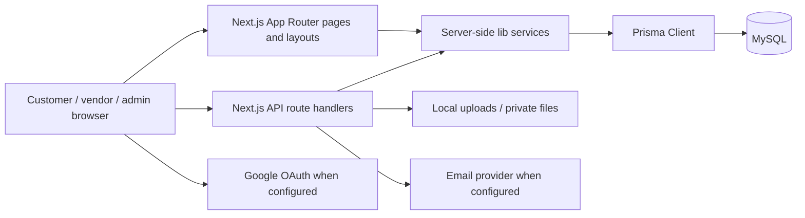
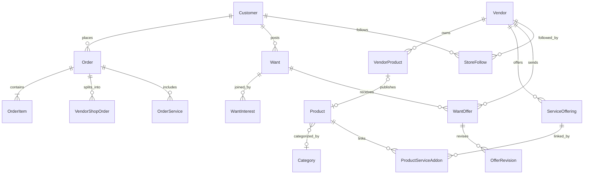
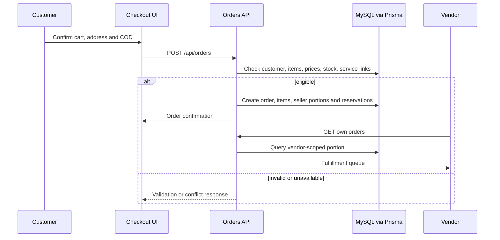
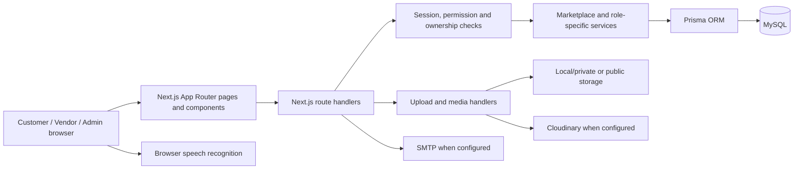
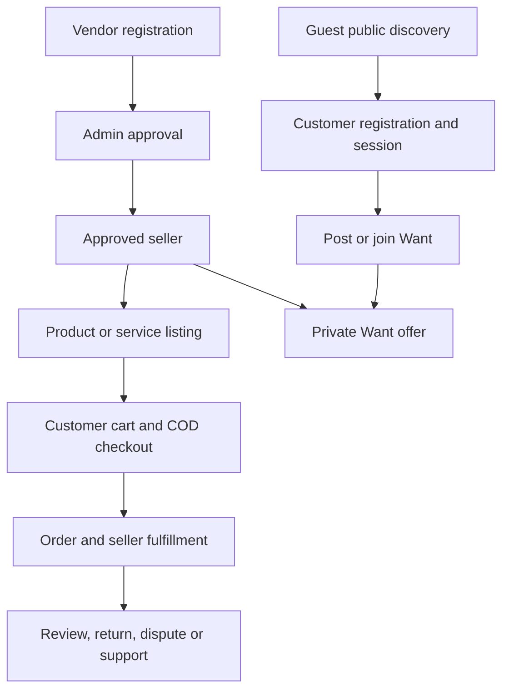

# JORO.pk — Complete Project Documentation

**As-is source review:** 11 October 2026 · **Scope:** local repository, read-only inspection. This document describes code paths, not a certification of deployed behavior. No database records, secrets, production logs, or live third-party accounts were inspected. “Implemented” means a concrete source path exists; runtime operation still depends on configuration, migrated data, and external services.

## 01. Executive Summary

JORO.pk is one Next.js marketplace application for public shopping, customer demand requests, vendor storefronts, and an administration panel. Customers can browse products and stores, maintain a cart, place Cash on Delivery (COD) orders, review delivered purchases, follow stores, create moderated Wants, join other Wants, and receive private vendor offers. Approved vendors manage products, services, storefronts, orders, demand offers, earnings, withdrawals, and support. Administrators control catalog data, moderation, seller approval, fulfillment, refunds, payouts, staff roles, promotions, and settings. The application uses Prisma with MySQL and several distinct authentication sessions.

The key distinction is **supply plus demand**: a customer may purchase an existing product or post a requirement for vendors to answer privately. JORO Connect currently presents those approved requests as a filtered feed; it is not a general social network. A standalone service listing leads to a service Want; a service becomes a charged product add-on only when a vendor explicitly links it to a product and the customer selects it.

Inventory: **111 App Router page files**, **144 API route files** exposing **202 HTTP handlers** (198 explicitly declared functions plus two NextAuth routes with GET and POST), **60 Prisma models**, and **24 migration directories**. These are source counts, not claims that each flow has been exercised. The route and API inventories below are exhaustive for the inspected tree.

## 02. What Is JORO.pk?

JORO is a Pakistan-oriented marketplace connecting customers with products, services, gifts, stores, and vendors. The public home page displays a hero, categories, featured/new products, services, seller promotions, and demand activity. A customer can post a Want when the catalog does not meet a need. Vendors can discover an approved open Want, send a private offer with terms, and the owner can negotiate or accept. The accepted quote is tied to checkout. Evidence: `app/(user)/page.tsx`, `app/(user)/joro-connect/page.tsx`, `app/api/wants/route.ts`, `app/api/vendor/offers/route.ts`, `app/api/offers/[id]/route.ts`, and `lib/offer-checkout-service.ts`.

## 03. Business Model and Marketplace Concept

| Participant | Supported value exchange | Code evidence |
|---|---|---|
| Customer/gift buyer | Browse, buy eligible products, request products/services/gifts, compare private offers, manage purchases | `app/(user)/products`, `gifts`, `wants`, `checkout`, `account`, `my-stuff` |
| Vendor/service provider | Publish owned catalog items and approved services, respond to demand, fulfill orders | `app/vendor/dashboard`, `app/api/vendor/*` |
| Administrator | Approve/moderate, configure category commissions, review payments/returns/payouts, curate homepage | `app/admin`, `lib/admin-rbac.ts` |

The schema and code support **category-based commission settings**, vendor earnings/ledger entries, withdrawal allocations, and curated or sponsored promotion records (`CommissionSetting`, `VendorEarning`, `PayoutAllocation`, `VendorPromotion`). These are real business rules in source; no paid subscription mechanism was found. Product checkout currently accepts COD only (`app/api/orders/route.ts` rejects other methods). Payouts and refunds are recorded as manual administrative actions with references, not verified bank/payment-gateway transfers. Promotion sponsorship is a data flag, not evidence of paid ad billing.

## 04. Technology Stack

| Layer | As-is implementation |
|---|---|
| Web | Next.js **14.2.35** App Router, React 18, TypeScript 5, server and client components; `pages/_app.tsx` and `_document.tsx` are compatibility files, not a separate application |
| Styling/UI | Tailwind 3.4, global CSS, CSS modules, Lucide icons, Framer Motion, `LoadingLink`/loading controls |
| Backend | Next.js `app/api/**/route.ts` handlers and server-side functions under `lib/` in the same deployment |
| Database | MySQL through Prisma Client/CLI 6.19; schema uses `DATABASE_URL` |
| Authentication | NextAuth v4 JWT sessions for customer and admin; separate signed vendor JWT plus `VendorSession` database record |
| State | React contexts for cart, customer auth/modal, vendor auth, Want posting; TanStack Query for selected client data |
| Images/files | Prisma `ProductImage` and payment proof BLOBs; local `public/uploads`; vendor private documents on server filesystem; optional Cloudinary support |
| Messaging | Nodemailer email helpers and stored customer/vendor notifications; no evidence of WebSocket push |
| Other | Zod validation, bcryptjs password hashes, `jose` vendor token signing, `rate-limiter-flexible`, QR generation, PDF invoice support |

Version claims come from `package.json`. Configuration is in `next.config.mjs`, `tsconfig.json`, `tailwind.config.ts`, `app/layout.tsx`, and `prisma/schema.prisma`. No separate frontend or backend service is defined in this repository.

## 05. High-Level System Architecture



The public route group is `app/(user)` and wraps pages with `UserRouteShell` (`CartProvider`, `CustomerAuthProvider`, `PostWantProvider`, announcement, navbar, footer). `app/vendor/dashboard/layout.tsx` verifies a vendor session on the server and requires approved status. `app/admin/layout.tsx` provides the admin shell; `middleware.ts` gates admin routes with an admin token and vendor dashboard routes with a vendor-cookie presence check, while server-side vendor session validation performs the substantive JWT/DB check. Customer endpoints make their own ownership checks. `app/providers.tsx` sets top-level providers. Data is not transferred through a separate API server.

## 06. Customer System — Complete Analysis

### Identity and profile

Email/password registration validates and sanitizes fields, hashes passwords with bcrypt, creates a customer and welcome notification (`app/api/customer/register/route.ts`). NextAuth credentials login verifies the hash and active status (`lib/customer-auth-options.ts`). The Google provider is added **only when configured**; its callback links a verified Google identity to `CustomerOAuthAccount` and prevents an unverified or inactive account from signing in (`lib/customer-oauth.ts`). NextAuth JWT sessions carry customer ID and `sessionVersion`; password reset invalidates older tokens. Customer and admin cookies have distinct names (`lib/auth-cookies.ts`). Logout uses NextAuth sign-out through customer UI. Reset-token and password APIs are under `/api/customer/*`. No customer approval workflow was found; `Customer.isActive` controls access. Profile name/phone can be updated; email is not a general profile edit field. Addresses, saved products, follows, notifications, and password controls have ownership-scoped APIs. Evidence: `context/CustomerAuthContext.tsx`, `components/user/CustomerProfileModal.tsx`, `app/(user)/account/page.tsx`, `app/api/customer/*`.

### Home, discovery and product shopping

`app/(user)/page.tsx` assembles the hero, categories/banners, new arrivals, best sellers, featured catalog, services, promotions, stores, and Wants from Prisma/service helpers; some legacy new-arrival rows still come from `data/products.json` via `lib/new-arrivals-catalog.ts`. `HomePersonalization` calls `/api/customer/home-activity` only for a customer session and checks returned customer ID; guests see public material, customers see their own request/join/order counts and welcome status, and vendor sessions show role-specific links. Product browsing uses `/products` with search/category/stock/price/sort; `/products/[id]` shows detail, variants, real linked seller when present, review stats, and optional linked service. `Category` records drive active categories; `giftProducts` identifies gifts by name/category terms rather than a separate Gift model. `/myhome` and `/deals` are explicit **Coming Soon** pages.

Reviews require a delivered order containing the product, are moderated, and only approved purchase-backed reviews appear publicly (`app/api/reviews/route.ts`, `lib/order-review-eligibility.ts`). `SavedProduct` backs the wishlist. The cart is client state persisted in local storage, namespaced by customer after login; it is not an authoritative stock/price store (`context/CartContext.tsx`). Cart lines support quantity, variant, and one optional service ID/price. Server checkout resolves prices again.

### Checkout and after-sales

The actual path is `/products/[id]` → cart → `/checkout` → `POST /api/orders` → order tracking/account. Checkout asks for contact, delivery city/address, COD, and displays settings-driven delivery charges. The order API requires a customer session, checkout idempotency key, active catalog product, valid variant, enough stock, COD-eligible city, and recalculates price/commission/add-on cost in a serializable transaction. It creates parent order, line items, seller-specific shop orders, inventory reservations, optional `OrderService`, and notifications. It does not charge an online payment provider. Shipping is represented by order/shop-order statuses and tracking number fields; no courier API integration was found. Customer orders and delivered purchases are distinct views: `/account` is account management, `/my-stuff` exposes delivered items, warranty, returns and disputes, while `/account/services` shows booked add-ons. Customer returns require delivered eligible items and quantity checks; vendor/admin actions and manual refund review follow. Evidence: `app/(user)/checkout/page.tsx`, `app/api/orders/route.ts`, `lib/order-inventory-service.ts`, `app/api/customer/returns/route.ts`, `lib/refund-service.ts`.

### Wants and private offers

Signed-in customers create product, service or gift Wants with title, category, city, budget/flexible budget, quantity, description, optional reference image, need-by/expiry (`lib/want-schema.ts`, `components/user/WantForm.tsx`). Submission defaults to `PENDING_MODERATION`; an admin opens it. Public feeds include only open unexpired Wants. A different customer can join/leave via `WantInterest`; ownership and active state are checked. Approved vendors submit one offer thread per Want with revisable terms; only the owner sees private offers on `GET /api/wants/[id]`. Owners can counter/reject/accept; acceptance creates a customer-bound `OfferQuote`, which is revalidated at checkout. Owner edits/close and admin moderation have separate guards. A joined customer sees the Want, not the owner's private offers. No direct buyer–seller chat endpoint for Wants was identified. Evidence: `app/api/wants/*`, `app/api/vendor/offers/route.ts`, `app/api/offers/[id]/route.ts`, `lib/offer-service.ts`.

### JORO Connect and Together

`/joro-connect` is a server-rendered feed of approved open `Want` records with product/service/gift type and city/search filters, counts, links to details/join, and paths to post. It currently has **no independent social-post, like, or comment model**. Store following is separate. `/together` is a different, private shopping-room module: customers create rooms, invite members with hashed expiring tokens, add products, comment/vote, and copy canonical items to cart (`ShoppingRoom`, `RoomMember`, `RoomInvite`, `RoomItem`, `RoomVote`, `RoomComment`; `app/api/together/*`). It is not the public Connect feed. No live socket/realtime transport was found; pages use fetch/navigation.

## 07. Vendor System — Complete Analysis

Vendor identity uses a **separate** registration/login path and vendor JWT cookie backed by a revocable `VendorSession`. Registration supports a full multipart business/document form (`/api/vendor/register`) and a simpler signup followed by onboarding (`/api/vendor/signup` → `/vendor/onboarding`); document and business validation differ between paths. Statuses include onboarding, pending, approved, rejected and suspended. Optional email verification depends on configuration. Admin approval unlocks dashboard/catalog actions. Login has rate limiting, failed-attempt lockout and status handling; suspension revokes sessions (`app/api/vendor/login/route.ts`, `lib/vendor-auth-server.ts`, `lib/vendor-onboarding.ts`).

Dashboard pages are inventoried in §10. Core sections: overview with real counts/recent orders; store profile/slug, banner/logo/policies, HTTPS public link and QR; owned product CRUD with `VendorProduct` → `Product` synchronization; services and product add-on links; approved Wants/demand and private offers; seller shop orders and status updates; returns/disputes; earnings/ledger and withdrawal requests; followers; notifications; account status/settings; support. `VendorSidebar` exposes these destinations. `app/vendor/dashboard/layout.tsx` redirects non-approved vendors to onboarding/status. API handlers normally scope reads and writes by `vendorId`, use `requireApprovedVendorApi` or `getVendorFromSession`, and service attachment verifies both product and service ownership. Vendor-specific order summaries use `VendorShopOrder`, while line-level sale/commission uses `VendorOrder` and `VendorEarning`.

Product publication is not a separate approval queue in the observed product-create path: an approved vendor creates a `VendorProduct` with active status and `syncVendorProductStorefront` creates/updates the linked public `Product`. Admin can manage catalog and vendor status. Standalone service listings require `active`, approved moderation, and approved vendor for public visibility; service request CTA posts a Want. Product-linked service orders use `ProductServiceAddon` and checkout revalidation. Earnings/withdrawals are ledger-backed, but transfers are manually marked by an admin rather than executed by a bank API. Store view/follower/revenue/order metrics exist in source; do not treat raw fields such as `viewsCount` as proof of instrumented analytics without the corresponding write path.

## 08. Admin System — Complete Analysis

Admin login is a separate NextAuth credentials configuration. `AdminUser` supports roles (`super_admin`, operations, finance, catalog, support, analyst), normalized extra permissions, active state, and audit records. `requireAdminPermission` reloads an active admin row for permission-sensitive APIs; an environment bootstrap admin path also exists (`lib/admin-auth-options.ts`, `lib/admin-rbac.ts`, `lib/admin-permissions.ts`). The sidebar lists dashboard, catalog/categories/new arrivals, service and Want moderation, parent and seller orders, after-sales, vendors, top vendors, promotions, customers, reviews, payouts/commission, notifications, support, team and settings.

| Admin section | Route | Main operation/API | Permission or status |
|---|---|---|---|
| Overview | `/admin/dashboard` | Orders/product metrics via `/api/orders`, `/api/products` | `dashboard.view` and API-specific rights |
| Catalog | `/admin/products`, `/admin/products/add`, `/admin/products/[id]/edit` | `/api/products`, `/api/products/[id]`, bestseller toggle | `catalog.manage` |
| Categories | `/admin/categories` | `/api/categories`, `/api/categories/[id]` | `catalog.manage` |
| New arrivals | `/admin/new-arrivals` plus add/edit | `/api/new-arrivals`, upload | `catalog.manage`; legacy JSON-backed path coexists |
| Service/Want moderation | `/admin/services`, `/admin/wants` | `/api/admin/services`, `/api/admin/wants` | `moderation.manage` |
| Orders | `/admin/orders`, `/admin/orders/[id]` | `/api/orders`, `/api/orders/[id]` | `orders.view/manage` |
| Seller shop orders | `/admin/vendor-orders`, detail | `/api/orders/admin/*` | `orders.view/manage` |
| Returns/disputes | `/admin/dashboard/after-sales` | `/api/admin/returns`, `/api/admin/disputes` | `returns.manage`, `disputes.manage` |
| Vendors | `/admin/vendors`, suspension detail | `/api/admin/vendors/*`, compliance/risk/appeal actions | `vendors.manage` |
| Top vendors/promotions | `/admin/vendors/top-vendors`, `/admin/vendor-promotions` | `/api/admin/top-vendors`, `/api/admin/vendor-promotions` | `homepage.manage` |
| Customers/reviews | `/admin/customers`, `/admin/reviews` | `/api/admin/customers/*`, `/api/admin/reviews/*` | `customers.manage`, `moderation.manage` |
| Payouts/commission | `/admin/dashboard/payouts`, `/admin/dashboard/commission-settings` | `/api/admin/payouts/*`, `/api/admin/commission-settings` | `payouts.manage`, `payments.manage` |
| Notifications/support | `/admin/notifications`, `/admin/support`, detail | `/api/admin/notifications`, `/api/admin/support/*` | moderation/support rights |
| Team/audit/settings | `/admin/dashboard/team`, `/admin/settings` | `/api/admin/team/*`, `/api/admin/audit`, `/api/settings` | staff/audit/settings rights |

Admin tools act on actual Prisma records, but external settlement, delivery, and email delivery still depend on human work/configuration. `AdminAuditLog` and `MarketplaceAudit` capture selected sensitive actions; this is not evidence that every read or every admin mutation is audited.

## 09. All Modules and Features

The complete feature-status matrix with routes/components/APIs/models/roles/limits is in §31. In addition to the requested modules, the repository includes **Together private shopping rooms**, support tickets with messages/attachments, store QR/slug aliases, vendor suspension/appeal controls, admin RBAC/audit, withdrawal allocation/ledger, verified reviews/warranties, legacy new-arrival catalog compatibility, and configurable homepage promotions.

## 10. Website Routes and Pages

`(user)` is a route group and does **not** appear in URLs. The 111 `page.tsx` files break down as **49 public/customer, 30 admin, 30 vendor, and 2 other** (`/login`, `/sell`). The home route `/` is counted inside `(user)`. Aliases such as `/account/orders` redirect to a tab on `/account`; they are real routes but not distinct data stores. The complete source-derived page index is in §36. Representative navigation:

| Area | Routes | Behavior |
|---|---|---|
| Public discovery | `/`, `/products`, `/products/[id]`, `/new-arrivals/[id]`, `/gifts`, `/services`, `/services/[id]`, `/stores`, `/stores/[slug]`, `/search` | Public listings, filtered search, details |
| Demand/community | `/wants`, `/wants/new`, `/wants/[id]`, `/wants/trending`, `/joro-connect`, `/joined-requests`, `/together`, `/together/[id]`, `/together/new`, `/join/[token]` | Moderated requests, joined list, private rooms |
| Customer private | `/account` and account subroutes, `/my-stuff`, `/cart`, `/checkout`, `/track-order`, `/invoice/[orderId]`, `/reviews` | Session/ownership checks in APIs; cart can be visited as guest |
| Account/support | `/account/help`, `/account/help/new`, `/account/help/tickets`, detail; `/reset-password` | Support ticket and recovery flows |
| Information | `/faq`, `/return-policy`, `/terms-and-conditions`, `/myhome`, `/deals` | Last two explicitly Coming Soon |
| Vendor | `/vendor/register`, `/vendor/login`, onboarding/status/recovery; `/vendor/dashboard/*` | Approved dashboard gated server-side |
| Admin | `/admin/login`, `/admin/dashboard/*`, catalog/order/moderation/staff/settings routes | Distinct admin session and permissioned APIs |

## 11. Database Models and Relationships

Source: `prisma/schema.prisma` (MySQL). All model names below are exact. Unless specified, the primary key is a string `id` with `cuid()` default. `@unique` and `@@unique` constrain identity; `@@index` accelerates access but does not guarantee uniqueness. JSON fields are application-validated, not relational tables. Status strings are often constrained in service code rather than Prisma enums. This is **schema evidence only**; migration application and record counts were not checked.

| Model | Purpose, important fields and relationships | Key constraints/status/indexes |
|---|---|---|
| `Customer` | Identity, email/hash/name/phone; parent of orders, Wants, addresses, follows, reviews, tickets | Unique email; `isActive`, `sessionVersion`; active/date index |
| `Product` | Public catalog item, price, stock, variants, category, images; optional linked `VendorProduct` | Unique optional `legacyNewArrivalId`; `isActive`, featured/bestseller; category/active indexes |
| `Category` | Named catalog category, image, home placement, ordering | Unique name, slug, optional legacy ID; `isActive` |
| `Review` | Product review, optional verified customer/order links | Integer auto ID; unique customer+product and order+product; approved/withdrawn indexes |
| `NewArrivalReview` | Legacy JSON new-arrival review | Integer auto ID; new-arrival/approved indexes; public approval policy differs from verified `Review` |
| `ProductImage` | Binary product image, MIME and sort order | Optional product FK; `MediumBlob` data |
| `PaymentProofStaging` | Temporary customer-owned binary proof upload | Customer/expiry indexes; staged file is separate from `Order` |
| `Order` | Parent checkout, buyer/contact/address, total, payment/order status, optional customer | Unique order number and optional checkout idempotency key; customer/date index |
| `OrderItem` | Snapshot of product name, unit price, quantity, image and variant | FK order; optional product FK; linked inventory/returns/warranty |
| `OrderInventoryLine` | Per-item stock reservation/release/consumption, vendor product/shop slice | Unique orderItemId; `InventoryReservationState`; order/state and vendor indexes |
| `OrderStatusEvent` | Actor/status audit timeline for an order | Optional unique idempotency key; order/date index |
| `CustomerPasswordResetToken` | Hashed expiring customer recovery token | Unique token hash; customer/expiry index |
| `CustomerNotification` | Private typed message/link/read flag | Unique idempotency key; customer/read/date index |
| `CustomerAddress` | Recipient, phone, city, optional default address | Customer/default index; default uniqueness is handled in service code |
| `SavedProduct` | Customer wishlist link to product | Composite PK customerId+productId; product index |
| `StoreFollow` | Customer-to-vendor follow relation | Unique customerId+vendorId; vendor/date index |
| `ReturnRequest` | Delivered line quantity, reason, vendor/admin review, tracking | `ReturnRequestStatus`, optional unique active key; customer/vendor/order indexes |
| `Dispute` | Customer complaint tied to order and optional return/vendor | `DisputeStatus`, optional unique active key; owner/vendor/order indexes |
| `Refund` | Amount, manual/external reference, processing state for a return | Unique returnRequestId and idempotency key; `RefundStatus`; owner/order/vendor indexes |
| `WarrantyRecord` | Delivered item's warranty dates/status | Unique orderItemId; customer/vendor/order indexes |
| `AdminUser` | Admin login, role and JSON extra permissions | Unique email; `isActive`; role/active index |
| `AdminAuditLog` | Admin actor/action/entity and request metadata | Admin/date, entity and date indexes |
| `Settings` | Singleton-style site name, COD cities/charge, contact and bank display fields | No separate FK; configuration stored in MySQL |
| `Vendor` | Seller/business/store/bank profile, approval, suspension, sales totals | Unique email, optional CNIC and storeSlug; `VendorAccountStatus`; status index |
| `VendorDocument` | Vendor identity/business document reference | Vendor FK/index; document type enum |
| `VendorProduct` | Seller-owned editable listing with images/pricing/stock | Unique optional `publishedProductId` links `Product`; `VendorProductStatus`; vendor index |
| `VendorOrder` | Vendor-specific line allocation, commission and tracking | Vendor/order/shop-order indexes; `VendorOrderStatus` |
| `VendorShopOrder` | Seller-specific split order with item JSON, totals and fulfillment | Unique shop order number; `VendorShopOrderStatus`; vendor/status/order/date indexes |
| `CommissionSetting` | Category-to-commission percentage | Unique categoryName; used to calculate vendor earnings |
| `VendorEarning` | Gross, commission, payable, reserve and paid amounts | Unique optional shop-order/service earning link; `VendorEarningStatus`; vendor/order indexes |
| `VendorWithdrawal` | Vendor request for manual payout to stored bank details | Optional unique open key; `VendorWithdrawalStatus`; vendor/status indexes |
| `PayoutAllocation` | Allocation of withdrawal amount across earnings | Unique withdrawalId+earningId; `PayoutAllocationStatus`; earning/status index |
| `VendorLedgerEntry` | Idempotent vendor money ledger event | Unique idempotency key; vendor/date and withdrawal indexes |
| `VendorReview` | Store/seller rating by customer, optionally order-backed | `isVisible`; vendor/customer indexes |
| `VendorCoupon` | Vendor code, discount type/value, usage and expiry | Unique vendorId+couponCode; `VendorCouponStatus`; vendor index; **redemption in checkout not established** |
| `VendorNotification` | Seller-facing message, event key, link/read flag | Optional unique eventKey; vendor/read indexes |
| `VendorSession` | Revocable hashed JWT session, expiry/IP/user agent | Unique tokenHash; vendor index; `isRevoked` |
| `VendorAuditLog` | Vendor action/security log, including appeal/suspension activity | Vendor/date indexes |
| `Want` | Customer request: type, category, city, budget, date, moderation, expiry | `WantStatus`; owner/date, type/status/expiry, category/city indexes |
| `WantInterest` | Customer joins a Want | Unique customerId+wantId; Want/date index |
| `WantOffer` | One vendor's private offer thread on a Want | Unique wantId+vendorId; status/version; vendor/status index |
| `OfferRevision` | Immutable terms revision, optional catalog product | Unique offerId+revisionNumber; price/quantity/shipping/expiry |
| `OfferQuote` | Accepted revision snapshot reserved for customer checkout | Unique Want, revision, idempotency key, optional order; expiry |
| `VendorPromotion` | Curated seller banner, placement, schedule and sponsorship flag | status/placement/time index; vendor FK; not billing evidence |
| `TopVendor` | Admin-selected featured seller and priority | Unique vendorId; enabled/priority index |
| `MarketplaceAudit` | Marketplace curation/actor/target/reason | Target/date index |
| `ShoppingRoom` | Private collaborative shopping room | `archived`; has members, items, invites |
| `RoomMember` | Customer room membership/owner role | Unique roomId+customerId; `active` |
| `RoomInvite` | Hashed expiring room invitation | Unique tokenHash; room index; `revoked` |
| `RoomItem` | Shared product/variant/quantity and addition-time price | Room index; member/product FK; current checkout re-prices |
| `RoomVote` | Member vote on shared item | Unique memberId+itemId |
| `RoomComment` | Member comment on shared item | Item index; text and date |
| `ServiceOffering` | Vendor service, type, price, cities, timing, warranty/terms | Vendor/active index; `active`, `moderationStatus` |
| `ProductServiceAddon` | Explicit optional product-to-service link | Unique productId+serviceId; `active`; ownership enforced in API/service code |
| `OrderService` | Purchased product-linked service snapshot, schedule/status/payable | Vendor/status and order indexes; links order, vendor, service; status string |
| `ServiceEvent` | Booking transition/action history | Service/date index |
| `StoreSlugAlias` | Old seller URL redirect/lookup | **Slug string is PK**; vendor FK |
| `SupportTicket` | Customer/vendor ticket, category, status, priority, assignment | Unique auto sequence (ID remains cuid); actor/status and assignment indexes |
| `SupportMessage` | Ticket reply/internal note and optional attachment | Ticket/date index; sender type/ID |
| `CustomerOAuthAccount` | External identity linked to customer | Unique provider+providerAccountId; customer index |

Important enum sets in the schema include inventory reservation, return/dispute/refund states, vendor account/business/document/product/order/earning/withdrawal/coupon states, payout allocation and Want state. The `Want.requestType` and `ServiceOffering.moderationStatus` fields are strings added by the two latest migration files with existing-row defaults `PRODUCT` and `APPROVED`. The 24 dated migrations show a progressive merge of legacy catalog, seller commerce, customer controls, support, and service/request moderation. Their presence does **not** prove they ran against a particular database.



`Product` is the public checkout/catalog record. `VendorProduct` is the seller-owned management record; `publishedProductId` binds them when synchronized (`lib/sync-vendor-product-storefront.ts`). Some catalog products are admin/legacy records without a linked vendor publication. Images can be stored as URLs in JSON or as `ProductImage` binary records. The public `Product.category` text and optional `categoryRecordId` coexist for legacy compatibility.

## 12. Backend APIs

The full route-handler inventory appears below. A route file may expose multiple methods; the inventory is at route-file granularity, while the methods column enumerates the actual handlers. The input/validation and result columns are concise **source-contract signals**, not a generated OpenAPI specification. Every table row points to its implementation under `app/api`. Common responses are JSON; `lib/marketplace-api.ts` maps authorization errors, Zod errors, unique/conflict errors and unavailable services to JSON error responses. Other legacy handlers construct `NextResponse` directly. Mutation handlers are not uniformly wrapped by the same origin checker, so endpoint-specific code remains authoritative. File/image handlers may return bytes or a redirect rather than JSON.

| Endpoint (`app/api/.../route.ts`) | Methods | Purpose / access | Expected input and validation signals | Main response keys | Direct Prisma models / errors |
|---|---|---|---|---|---|
| `/api/account/offers` | GET | account / offers; Customer owner | none or session | offers | wantOffer; shared API errors |
| `/api/account/quotes/[id]` | GET | account / quotes; Customer owner | path parameter | JSON, handler-specific | offerQuote; shared API errors |
| `/api/account/support/resources` | GET | support / resources; Customer owner | query | resources | via helper or none; shared API errors |
| `/api/account/support/tickets/[id]/messages` | POST | tickets / messages; Customer owner | path parameter, multipart, origin check | message | via helper or none; shared API errors |
| `/api/account/support/tickets/[id]/reopen` | POST | tickets / reopen; Customer owner | path parameter, origin check | ticket | via helper or none; shared API errors |
| `/api/account/support/tickets/[id]` | GET | support / tickets; Customer owner | path parameter | ticket | supportTicket; shared API errors |
| `/api/account/support/tickets` | GET/POST | support / tickets; Customer owner | query, multipart, origin check | ticket, tickets | supportTicket; shared API errors |
| `/api/admin/audit` | GET | admin / audit; Admin permission | none or session | audit | adminAuditLog; shared API errors |
| `/api/admin/auth/[...nextauth]` | GET/POST | Authentication session/callback; Public auth entry | path parameter | session/callback | via helper or none; shared API errors |
| `/api/admin/commission-settings` | GET/PATCH | admin / commission-settings; Admin permission | JSON, Zod/schema | categories, ok | commissionSetting; 400 |
| `/api/admin/customers/[id]` | PATCH | admin / customers; Admin permission | path parameter, JSON, Zod/schema | customer | customer; 400/404 |
| `/api/admin/customers` | GET | admin / customers; Admin permission | query | customers | customer; shared API errors |
| `/api/admin/disputes/[id]` | PATCH | admin / disputes; Admin permission | path parameter, JSON, Zod/schema | dispute | dispute, orderStatusEvent; 400/404/409/500 |
| `/api/admin/disputes` | GET | admin / disputes; Admin permission | query | disputes | dispute; shared API errors |
| `/api/admin/notifications` | GET | admin / notifications; Admin permission | none or session | id, notifications | vendorAuditLog; 500 |
| `/api/admin/payouts/[id]` | PATCH | admin / payouts; Admin permission | path parameter, JSON, Zod/schema | ok | vendorWithdrawal; 400/404 |
| `/api/admin/payouts` | GET | admin / payouts; Admin permission | none or session | stats | vendorEarning, vendorWithdrawal; shared API errors |
| `/api/admin/products/[id]/bestseller` | PATCH | products / bestseller; Admin permission | path parameter | ok | product; 400/404 |
| `/api/admin/returns/[id]` | PATCH | admin / returns; Admin permission | path parameter, JSON, Zod/schema | return | orderStatusEvent, refund, returnRequest; 400/404/500 |
| `/api/admin/returns` | GET | admin / returns; Admin permission | query | returns | returnRequest; shared API errors |
| `/api/admin/reviews/[id]` | PATCH/DELETE | admin / reviews; Admin permission | path parameter, query, JSON | ok | newArrivalReview, review; 400/403/404/409/500 |
| `/api/admin/reviews` | GET | admin / reviews; Admin permission | none or session | reviews | newArrivalReview, review; 500 |
| `/api/admin/services` | GET/PATCH | admin / services; Admin permission | JSON, Zod/schema, origin check | service | serviceOffering; shared API errors |
| `/api/admin/sidebar-badges` | GET | admin / sidebar-badges; Admin permission | none or session | JSON, handler-specific | vendor, vendorAuditLog, vendorShopOrder; 500 |
| `/api/admin/support/assignees` | GET | support / assignees; Admin permission | none or session | JSON, handler-specific | adminUser; shared API errors |
| `/api/admin/support/tickets/[id]/messages` | POST | tickets / messages; Admin permission | path parameter, multipart, origin check | message | via helper or none; shared API errors |
| `/api/admin/support/tickets/[id]` | GET/PATCH | support / tickets; Admin permission | path parameter, JSON, Zod/schema, origin check | ticket | supportTicket; shared API errors |
| `/api/admin/support/tickets` | GET | support / tickets; Admin permission | query | tickets | supportTicket; shared API errors |
| `/api/admin/team/[id]` | PATCH | admin / team; Admin permission | path parameter, JSON, Zod/schema | admin | adminUser; 400/404/409 |
| `/api/admin/team` | GET/POST | admin / team; Admin permission | JSON, Zod/schema | admin, admins | adminUser; 201/400/409/500 |
| `/api/admin/top-vendors` | GET/POST/PATCH/DELETE | admin / top-vendors; Admin permission | query, JSON, Zod/schema, origin check | ok, topVendor, topVendors | marketplaceAudit, topVendor, vendor; shared API errors |
| `/api/admin/vendor-promotions` | GET/PUT/DELETE | admin / vendor-promotions; Admin permission | query, JSON, Zod/schema, origin check | ok | marketplaceAudit, vendor, vendorPromotion; shared API errors |
| `/api/admin/vendors/[id]/appeals/[appealId]/resolve` | PATCH | appeals / resolve; Admin permission | path parameter | ok | vendorAuditLog; 400/404 |
| `/api/admin/vendors/[id]/risk-score` | GET | vendors / risk-score; Admin permission | path parameter | JSON, handler-specific | vendor; 400/404/500 |
| `/api/admin/vendors/[id]` | PATCH | admin / vendors; Admin permission | path parameter, JSON, Zod/schema | ok | vendor, vendorAuditLog; 400/404/409/500 |
| `/api/admin/vendors/[id]/suspension` | GET | vendors / suspension; Admin permission | path parameter | vendor | vendor, vendorAuditLog; 400/404 |
| `/api/admin/vendors/check-compliance` | POST | vendors / check-compliance; Admin permission | none or session | checked | vendor, vendorAuditLog; 500 |
| `/api/admin/vendors` | GET | admin / vendors; Admin permission | query | JSON, handler-specific | vendor; 500 |
| `/api/admin/wants` | GET/PATCH | admin / wants; Admin permission | JSON, Zod/schema, origin check | JSON, handler-specific | marketplaceAudit, want; 400/503 |
| `/api/auth/[...nextauth]` | GET/POST | Authentication session/callback; Public auth entry | path parameter | session/callback | via helper or none; shared API errors |
| `/api/categories/[id]` | PUT/DELETE | categories; Public/read role by method; admin writes | path parameter, JSON | ok | via helper or none; 400/404/500 |
| `/api/categories` | GET/POST | categories; Public/read role by method; admin writes | JSON | JSON, handler-specific | via helper or none; 201/400/500 |
| `/api/customer/account` | GET | customer / account; Customer owner | query | profile | customer, customerAddress, customerNotification, order, orderService, returnRequest, storeFollow, want, wantOffer; shared API errors |
| `/api/customer/addresses/[id]` | PATCH/DELETE | customer / addresses; Customer owner | path parameter, JSON, origin check | address, ok | customerAddress; shared API errors |
| `/api/customer/addresses` | GET/POST | customer / addresses; Customer owner | JSON, Zod/schema, origin check | address, addresses | customerAddress; shared API errors |
| `/api/customer/disputes` | GET/POST | customer / disputes; Customer owner | JSON, Zod/schema | dispute, disputes | dispute, order, orderStatusEvent, returnRequest; 201/400/404/409/500 |
| `/api/customer/forgot-password` | POST | customer / forgot-password; Public GET; gated writes if present | JSON | JSON, handler-specific | customer, customerPasswordResetToken; 400/429/502/503 |
| `/api/customer/home-activity` | GET/PATCH | customer / home-activity; Customer owner | origin check | customerId, ok | customerNotification, order, want, wantInterest, wantOffer; shared API errors |
| `/api/customer/my-stuff` | GET | customer / my-stuff; Customer owner | none or session | items | order; shared API errors |
| `/api/customer/notifications/[id]` | PATCH | customer / notifications; Customer owner | path parameter, origin check | ok | customerNotification; shared API errors |
| `/api/customer/notifications` | GET/PATCH | customer / notifications; Customer owner | origin check | ok | customerNotification; shared API errors |
| `/api/customer/orders/[id]` | GET | customer / orders; Customer owner | path parameter | order | order; shared API errors |
| `/api/customer/password/google-reauth` | POST | password / google-reauth; Customer owner | origin check | ok | customer; 403/409/500 |
| `/api/customer/password` | POST | customer / password; Customer owner | JSON, Zod/schema, origin check | ok | customer; 400/401/403/409/500 |
| `/api/customer/profile` | GET/PATCH | customer / profile; Customer owner | JSON, Zod/schema, origin check | JSON, handler-specific | customer; shared API errors |
| `/api/customer/register` | POST | customer / register; Public auth entry | JSON, Zod/schema, origin check | ok | customer; shared API errors |
| `/api/customer/reset-password` | POST | customer / reset-password; Public GET; gated writes if present | JSON, Zod/schema | ok | customer, customerPasswordResetToken; 400/500 |
| `/api/customer/returns/[id]` | PATCH | customer / returns; Customer owner | path parameter, JSON, Zod/schema | return | returnRequest; 400/409 |
| `/api/customer/returns` | GET/POST | customer / returns; Customer owner | JSON, Zod/schema | return, returns | orderItem, orderStatusEvent, returnRequest, vendorNotification; 201/400/404/409/500 |
| `/api/customer/saved-products/[productId]` | DELETE | customer / saved-products; Customer owner | path parameter, origin check | ok | savedProduct; shared API errors |
| `/api/customer/saved-products` | GET/POST | customer / saved-products; Customer owner | query, JSON, Zod/schema, origin check | ids, ok, products | product, savedProduct; shared API errors |
| `/api/image/[id]` | GET | image; Public/read role by method; admin writes | path parameter | binary/guarded result | productImage; 200/404 |
| `/api/new-arrivals/[id]` | GET/PUT/DELETE | new-arrivals; Public/read role by method; admin writes | path parameter, JSON | ok | via helper or none; 400/404/500 |
| `/api/new-arrivals` | GET/POST | new-arrivals; Public/read role by method; admin writes | JSON | JSON, handler-specific | via helper or none; 201/400/500 |
| `/api/offers/[id]` | PATCH | offers; Customer/participant; vendor action | path parameter, JSON, Zod/schema, origin check | offer, quote | offerQuote, offerRevision, wantOffer; shared API errors |
| `/api/order-payment/[orderId]` | GET | order-payment; Public/read role by method; admin writes | path parameter | binary/guarded result | order; 200/404 |
| `/api/order-payment-staging/[id]` | GET | order-payment-staging; Public GET; gated writes if present | path parameter | binary/guarded result | paymentProofStaging; 200/401/404 |
| `/api/orders/[id]/cancel` | POST | orders / cancel; Public GET; gated writes if present | path parameter, JSON | JSON, handler-specific | order, vendorShopOrder; 401/404/409 |
| `/api/orders/[id]` | GET/PUT | orders; Public/read role by method; admin writes | path parameter, query, JSON | JSON, handler-specific | order, orderStatusEvent, paymentProofStaging, vendorShopOrder; 400/403/404/409 |
| `/api/orders/admin/all` | GET | admin / all; Admin permission | query | JSON, handler-specific | vendorShopOrder; shared API errors |
| `/api/orders/admin/shop/[id]/cancel` | PATCH | shop / cancel; Admin permission | path parameter, JSON, Zod/schema | ok | vendorShopOrder; 400 |
| `/api/orders/admin/shop/[id]` | GET | admin / shop; Admin permission | path parameter | order | vendorShopOrder; 404 |
| `/api/orders/admin/shop/[id]/status` | PATCH | shop / status; Admin permission | path parameter, JSON, Zod/schema | ok | via helper or none; 400/500 |
| `/api/orders/mine` | GET | orders / mine; Public GET; gated writes if present | none or session | orders | order; 401 |
| `/api/orders` | GET/POST | orders; Public/read role by method; admin writes | query, JSON | orders, serviceId | customer, offerQuote, order, orderInventoryLine, orderItem, orderService, orderStatusEvent, product, vendorProduct, vendorShopOrder, want; 400/401/409/500 |
| `/api/orders/stats` | GET | orders / stats; Public/read role by method; admin writes; vendor action | none or session | scope | via helper or none; 401 |
| `/api/orders/vendor/[id]/cancel` | PATCH | vendor / cancel; Vendor owner | path parameter, JSON, Zod/schema | ok | via helper or none; 400 |
| `/api/orders/vendor/[id]` | GET | orders / vendor; Vendor owner | path parameter | order | vendorShopOrder; 404 |
| `/api/orders/vendor/[id]/status` | PATCH | vendor / status; Vendor owner | path parameter, JSON, Zod/schema | ok | via helper or none; 400/403/500 |
| `/api/orders/vendor` | GET | orders / vendor; Public GET; gated writes if present | query | JSON, handler-specific | vendorShopOrder; shared API errors |
| `/api/private/support-attachments/[messageId]` | GET | private / support-attachments; Public/read role by method; admin writes; vendor action | path parameter | binary/guarded result | supportMessage; 404/500 |
| `/api/private/vendor-appeals/[vendorId]/[fileName]` | GET | private / vendor-appeals; Public/read role by method; admin writes | path parameter | binary/guarded result | via helper or none; 404 |
| `/api/private/vendor-documents/[id]` | GET | private / vendor-documents; Public/read role by method; admin writes; vendor action | path parameter | binary/guarded result | vendorDocument; 404/500 |
| `/api/product-categories` | GET | product-categories; Public GET; gated writes if present | none or session | JSON, handler-specific | via helper or none; shared API errors |
| `/api/products/[id]` | GET/PUT/DELETE | products; Public/read role by method; admin writes | path parameter, JSON | ok | product, productImage; 400/404/500 |
| `/api/products/[id]/services` | GET | products / services; Public GET; gated writes if present | path parameter | services | productServiceAddon; shared API errors |
| `/api/products/bestsellers` | GET | products / bestsellers; Public GET; gated writes if present | query | JSON, handler-specific | via helper or none; 503 |
| `/api/products/new-arrivals` | GET | products / new-arrivals; Public GET; gated writes if present | query | products | via helper or none; 500 |
| `/api/products` | GET/POST | products; Public/read role by method; admin writes | query, JSON | products | product, productImage; 400/500 |
| `/api/products/search` | GET | products / search; Public GET; gated writes if present | query | id, products | product; 500 |
| `/api/reviews/[productId]` | GET | reviews; Public GET; gated writes if present | path parameter | JSON, handler-specific | via helper or none; 400/500 |
| `/api/reviews/all` | GET | reviews / all; Public GET; gated writes if present | none or session | JSON, handler-specific | via helper or none; 500 |
| `/api/reviews/check/[orderId]/[productId]` | GET | reviews / check; Public GET; gated writes if present | path parameter | review | order, review; 400/401/404 |
| `/api/reviews/photo` | POST | reviews / photo; Public/read role by method; customer action | multipart, Zod/schema, origin check | id | order; shared API errors |
| `/api/reviews` | GET/POST/PATCH/DELETE | reviews; Public/read role by method; customer action | query, JSON, Zod/schema, origin check | reviews, success | order, review; shared API errors |
| `/api/search/suggestions` | GET | search / suggestions; Public GET; gated writes if present | query | items | via helper or none; 503 |
| `/api/services/bookings` | GET/PATCH | services / bookings; Public/read role by method; customer action; vendor action | query, JSON, Zod/schema, origin check | bookings, success | orderService, serviceEvent, vendorEarning; shared API errors |
| `/api/services` | GET | services; Public GET; gated writes if present | query | services | via helper or none; shared API errors |
| `/api/settings` | GET/PUT | settings; Public/read role by method; admin writes | JSON | JSON, handler-specific | via helper or none; shared API errors |
| `/api/stores/[id]/follow` | GET/PUT/DELETE | stores / follow; Public/read role by method; customer action | path parameter, origin check | JSON, handler-specific | storeFollow, vendor; shared API errors |
| `/api/stores` | GET | stores; Public GET; gated writes if present | none or session | JSON, handler-specific | via helper or none; shared API errors |
| `/api/together/[id]` | GET/POST | together; Customer/participant | path parameter, JSON, Zod/schema, origin check | invitePath, lines, room, success | roomComment, roomInvite, roomItem, roomMember, shoppingRoom; shared API errors |
| `/api/together/join` | POST | together / join; Customer/participant | JSON, Zod/schema, origin check | roomId | roomInvite, roomMember; shared API errors |
| `/api/together` | GET/POST | together; Public/read role by method; customer action | JSON, Zod/schema, origin check | room, rooms | shoppingRoom; shared API errors |
| `/api/upload` | POST | upload; Public/read role by method; admin writes | multipart | id | paymentProofStaging, productImage; 400/401/403/500 |
| `/api/vendor/appeal` | POST | vendor / appeal; Vendor session/owner | JSON, Zod/schema | ok | vendor, vendorAuditLog; 400/401/404/500 |
| `/api/vendor/appeal/upload` | POST | appeal / upload; Vendor session/owner | multipart | url | vendor; 400/401/403/429/500 |
| `/api/vendor/bank` | GET/PATCH | vendor / bank; Vendor session/owner | JSON, Zod/schema | ok | vendor; 400 |
| `/api/vendor/check-email` | GET | vendor / check-email; Public GET; gated writes if present | query | available | vendor; 429 |
| `/api/vendor/disputes` | GET | vendor / disputes; Vendor session/owner | none or session | disputes | dispute; shared API errors |
| `/api/vendor/earnings` | GET | vendor / earnings; Vendor session/owner | none or session | summary | vendorEarning, vendorLedgerEntry, vendorWithdrawal; shared API errors |
| `/api/vendor/forgot-password` | POST | vendor / forgot-password; Public GET; gated writes if present | JSON, Zod/schema | JSON, handler-specific | vendor; 400/429/502/503 |
| `/api/vendor/login` | POST | vendor / login; Public auth entry | JSON, Zod/schema | httpOnly, ok | vendor, vendorAuditLog, vendorSession; 400/401/403/423/429 |
| `/api/vendor/logout` | POST | vendor / logout; Vendor session/owner | none or session | ok | vendorSession; shared API errors |
| `/api/vendor/me` | GET | vendor / me; Vendor session/owner | none or session | vendor | via helper or none; 401 |
| `/api/vendor/notifications/[id]` | PATCH | vendor / notifications; Vendor session/owner | path parameter | ok | vendorNotification; 404 |
| `/api/vendor/notifications` | GET/PATCH | vendor / notifications; Vendor session/owner | JSON | ok | vendorNotification; 400 |
| `/api/vendor/offers` | GET/POST | vendor / offers; Vendor session/owner | JSON, origin check | offers | want, wantOffer; shared API errors |
| `/api/vendor/onboarding` | GET/PATCH/POST | vendor / onboarding; Vendor session/owner | multipart, JSON, Zod/schema, origin check | fields, ok, vendor | vendor; shared API errors |
| `/api/vendor/orders/[id]` | GET/PATCH | vendor / orders; Vendor session/owner | path parameter, JSON, Zod/schema | ok, order | vendorOrder; 400/404/500 |
| `/api/vendor/orders` | GET | vendor / orders; Vendor session/owner | query | orders | vendorOrder; shared API errors |
| `/api/vendor/products/[id]` | GET/PATCH/DELETE | vendor / products; Vendor session/owner | path parameter, JSON, Zod/schema | ok, product | vendorProduct; 400/404/500 |
| `/api/vendor/products` | GET/POST | vendor / products; Vendor session/owner | JSON, Zod/schema | ok, products | vendorProduct; 400/500 |
| `/api/vendor/register` | POST | vendor / register; Public auth entry | multipart, Zod/schema | ok | vendor; 400/409/429/500 |
| `/api/vendor/resend-verification` | POST | vendor / resend-verification; Public GET; gated writes if present | JSON, Zod/schema | ok | vendor; 200/400/429/502 |
| `/api/vendor/reset-password` | POST | vendor / reset-password; Public GET; gated writes if present | JSON, Zod/schema | ok | vendor, vendorAuditLog, vendorSession; 400/500 |
| `/api/vendor/returns/[id]` | PATCH | vendor / returns; Vendor session/owner | path parameter, JSON, Zod/schema | return | orderStatusEvent, returnRequest; 400/409/500 |
| `/api/vendor/returns` | GET | vendor / returns; Vendor session/owner | none or session | returns | returnRequest; shared API errors |
| `/api/vendor/services` | GET/POST | vendor / services; Vendor session/owner | JSON, Zod/schema, origin check | addon, service, success | orderService, product, productServiceAddon, serviceOffering; shared API errors |
| `/api/vendor/signup` | POST | vendor / signup; Public auth entry | JSON, Zod/schema, origin check | ok | vendor; shared API errors |
| `/api/vendor/store` | GET/PATCH | vendor / store; Vendor session/owner | JSON, Zod/schema, origin check | success | marketplaceAudit, storeSlugAlias, vendor; shared API errors |
| `/api/vendor/support/resources` | GET | support / resources; Vendor session/owner | query | resources | via helper or none; shared API errors |
| `/api/vendor/support/tickets/[id]/messages` | POST | tickets / messages; Vendor session/owner | path parameter, multipart, origin check | message | via helper or none; shared API errors |
| `/api/vendor/support/tickets/[id]/reopen` | POST | tickets / reopen; Vendor session/owner | path parameter, origin check | ticket | via helper or none; shared API errors |
| `/api/vendor/support/tickets/[id]` | GET | support / tickets; Vendor session/owner | path parameter | ticket | supportTicket; shared API errors |
| `/api/vendor/support/tickets` | GET/POST | support / tickets; Vendor session/owner | query, multipart, origin check | ticket, tickets | supportTicket; shared API errors |
| `/api/vendor/upload` | POST | vendor / upload; Vendor session/owner | multipart | JSON, handler-specific | via helper or none; 400/429/500 |
| `/api/vendor/verify-email` | GET | vendor / verify-email; Public GET; gated writes if present | query | JSON, handler-specific | vendor; shared API errors |
| `/api/vendor/withdrawals` | GET/POST | vendor / withdrawals; Vendor session/owner | JSON, Zod/schema | ok, withdrawals | vendor, vendorWithdrawal; 400/500 |
| `/api/wants/[id]/interest` | GET/PUT/DELETE | wants / interest; Public/read role by method; customer action | path parameter, origin check | joined | want, wantInterest; shared API errors |
| `/api/wants/[id]` | GET/PATCH | wants; Public/read role by method; customer action | path parameter, JSON, origin check | want | want, wantOffer; shared API errors |
| `/api/wants/feed` | GET | wants / feed; Public/read role by method; customer action | query | JSON, handler-specific | want; shared API errors |
| `/api/wants/joined` | GET | wants / joined; Public/read role by method; customer action | none or session | wants | wantInterest; shared API errors |
| `/api/wants` | GET/POST | wants; Public/read role by method; customer action | query, JSON, origin check | wants | want; shared API errors |

### Security-sensitive API contract examples

The route table gives per-file input/response signals. The following method-level examples clarify the main privacy and transaction boundaries; consult each handler for optional fields and exact serialized objects.

| Method and endpoint | Input / validation | Authorization and primary result | Main failures |
|---|---|---|---|
| `GET /api/orders` | Optional `status` query | `orders.view` admin permission; `{orders, unread}` | 403 or database 500 |
| `POST /api/orders` | JSON cart/contact/city/address/payment, 16–128-character `Idempotency-Key` or `checkoutKey`; server recalculates product, stock, shipping and add-on | Active customer session; serialized order with confirmation number; transaction writes order/items/vendor slices/reservations | 400 invalid/unsupported payment, 401 unauthenticated, 409 key/stock conflict, 500 failure |
| `GET /api/wants` | `mine=1` or public city/category/sort query | Public open/trending list; `mine=1` requires customer and returns own Wants as `{wants}` | Auth failure for private mode; service errors |
| `POST /api/wants` | JSON `wantInput` with expiry no more than 90 days ahead; same-origin and text sanitization | Customer session; `{want: {id, status}}`, draft or pending moderation | 400 validation/expiry; auth failure |
| `GET /api/vendor/offers` | Vendor session | Own offer threads in `{offers}` | 401 missing session |
| `POST /api/vendor/offers` | JSON `wantId` plus `offerTerms`, same-origin; valid expiry and optional owned product | Approved vendor; serializable transaction creates offer/revision and customer notification; `{offer}` | 403 unapproved, 409 closed/duplicate Want, validation error |
| `GET /api/products/[id]/services` | Product path ID | Public active product with active, approved linked services | Empty link set for ineligible product/service |
| `GET /api/search/suggestions` | Query string with normalization/limits | Public suggestions only, never private quotes | Empty/invalid query or service failure |
| `POST /api/customer/returns` | Owned delivered order item, quantity/reason | Customer-scoped `ReturnRequest` | Ineligible status/quantity, missing ownership, conflict |
| `PATCH /api/admin/returns/[id]` | Validated action including manual refund creation/processing | Permissioned administrator; updates return/refund/status | 400 amount/state, 404 record, 409 conflict |

Authentication labels in the full inventory summarize the route family, not every branch: for example public `GET /api/wants` has a customer-only `mine=1` mode, and `GET /api/orders` is admin-only while its `POST` is customer-only. Never infer permission merely from an endpoint's prefix.

## 13. Authentication and Permissions

Customer and admin use distinct NextAuth JWT cookies; vendor uses a signed JWT whose hash and expiry must match `VendorSession`. Authentication itself is not authorization: customer APIs check `customerId`, vendor APIs check `vendorId` and approval, admin APIs use permission strings. Middleware protects `/admin/*` and `/vendor/dashboard/*`, but server route/layout checks are the decisive boundary. `getVendorFromSession` rejects revoked/expired sessions and suspended vendors; approved status is required for commerce management. `customerActor` checks active customer records; `requireAdminPermission` consults current active admin data. Public product, service, store and Want queries filter to allowed states. Private offers are returned to the Want owner and offer participants through scoped APIs, not public search. The role matrix in §33 gives the practical differences.

## 14. Product and Category Architecture

`Product` is the public catalog record used for browsing, search, detail, cart pricing and order items. `VendorProduct` is the seller-managed listing; vendor product routes synchronize publishable data into `Product`. They are connected views, not independent customer catalogs. `Category` supports managed categories and legacy identifiers. Public queries filter visibility and status. Variants and stock are rechecked at checkout. Images may be URL backed or stored in `ProductImage`. Gifts are filtered `Product` records matching category/name terms through `lib/gift-products.ts`; there is no separate gift model. `VendorCoupon` exists in the schema, but checkout does not redeem it. Source: `prisma/schema.prisma`, `app/api/products`, `app/api/vendor/products`, `lib/marketplace-api.ts`, `app/(user)/products`.

## 15. Store and Vendor Architecture

`Vendor` holds business and store profile, status, contact and media fields. Registration/onboarding precedes admin review; approved vendors manage listings. Public store pages resolve slugs and historical aliases and expose eligible stores. Customers can follow stores (`StoreFollow`); vendors can share public URL/QR codes. Dashboard views/followers/sales are queried metrics, not a complete analytics platform. Vendor JWTs pair with `VendorSession` for revocation and ownership checks. Source: `app/vendor`, `app/(user)/stores`, `app/api/vendor/store`, `app/api/stores`, `components/vendor/StoreQr.tsx`.

## 16. Services and Product Add-ons

Approved vendors manage `ServiceOffering` records. Public discovery requires active service, accepted moderation state and approved seller. Standalone service interest routes into the Want/request workflow; booking UI/models do not establish instant paid standalone booking. Sellers can link a service to a product through `ProductServiceAddon`. Checkout rechecks the link, price/quote and availability before creating `OrderService`; cart-supplied service prices are not trusted. Admin moderation and vendor management are separate. Source: `app/api/vendor/services`, `app/api/admin/services`, `app/api/products/[id]/services`, `app/api/services/bookings`, `components/user/ProductServices.tsx`.

## 17. Wants, Offers and JORO Connect

Signed-in customers post `Want` requests with type, description, category/city/budget and optional images. Public feeds show eligible open requests; owners can close them, and other customers join/leave through `WantInterest`. Approved vendors discover Wants and submit `WantOffer`/`OfferQuote` data. Offers are scoped to the owner and permitted participants through authenticated APIs. JORO Connect is this moderated demand feed, filters, joined requests and seller-offer workflow. No separate Connect likes/comments or socket delivery was established. `/together` is a distinct private group-shopping feature with rooms, comments/votes and invitations. Source: `app/(user)/joro-connect`, `app/api/wants`, `app/api/vendor/offers`, `app/api/together`, `components/user/WantForm.tsx`.

## 18. Cart, Checkout and Orders

`CartContext` keeps a customer-scoped browser cart; local storage is convenience state, never a trusted price or ownership source. Checkout requires customer authentication and address, recomputes products, variants, quantities, add-ons, shipping and totals server-side, and applies idempotency. `/api/orders` creates `Order`, `OrderItem`, seller-specific order records and inventory reservations. Eligible cities and COD rules constrain checkout. Customers see only their orders, vendors their fulfillment portions, admins the full order. Coupon redemption is not active. Source: `context/CartContext.tsx`, `app/(user)/checkout`, `app/api/orders`, `app/api/vendor/orders`.

## 19. Payments, Delivery and Returns

Checkout implements cash on delivery in eligible locations. Bank/proof, payment and payout models support records but do not establish a live card/wallet/bank gateway. Earnings, withdrawals, commissions and admin refund/payout actions involve manual operations. Delivery statuses are app-managed; no courier API was verified. Customers can submit eligible returns and disputes; `WarrantyRecord` tracks coverage on delivered items, rather than a separate warranty-claim API. Vendor/admin handlers record decisions and status events. Automated reverse settlement is not evidenced. Source: `app/api/orders`, `app/api/customer/returns`, `app/api/customer/disputes`, `app/api/vendor/returns`, `app/api/admin/returns/[id]`, `app/api/vendor/withdrawals`.

## 20. Search and Voice Search

`/search` normalizes queries and groups public products, services, gifts, open Wants, categories and approved stores. Result links lead to public pages and preserve their access checks. Header search uses the same destination/suggestions. Voice search uses browser `SpeechRecognition`/`webkitSpeechRecognition`, `en-PK`/`ur-PK`, microphone permission handling and separate recognition error messages. A transcript fills and submits the search. Browser support, permission and the browser recognition service are dependencies; there is no server speech-to-text. Source: `app/(user)/search/page.tsx`, `lib/public-search.ts`, `components/SearchBar.tsx`, `next.config.mjs`.

## 21. Notifications and Personalization

Customer/vendor notification records and APIs support in-app unread/read state; email depends on SMTP configuration. No websocket or browser push was established. The homepage combines public sections with `HomePersonalization`: guests see no private customer data; customers get owner-scoped requests, joined activity, authorized offers and welcome text; vendors see relevant links/status. Customer and vendor auth contexts remain separate. API ownership checks, rather than UI hiding, protect private data. Source: `components/user/HomePersonalization.tsx`, `context/CustomerAuthContext.tsx`, `context/VendorAuthContext.tsx`, `app/(user)/page.tsx`.

## 22. Frontend Components and UI Architecture

Next App Router groups public pages in `app/(user)`, vendor pages in `app/vendor`, and administration in `app/admin`. Server pages fetch data; client components handle forms, state and browser APIs. Shared, customer, vendor and admin UI lives under `components/`; `context/` supplies auth/cart/Want state and `hooks/` navigation/loading helpers. Tailwind, global CSS and CSS modules implement layout/responsive rules; dedicated components implement the hero, footer, banners and auth screens. `LoadingLink` and route loading UI provide navigation feedback. Client validation is supplemented by server Zod/explicit checks. Responsive and accessibility code was inspected, but no visual or assistive-technology audit was run. Source: `app/layout.tsx`, role layouts, `components/ui`, `tailwind.config.ts`.

## 23. Complete End-to-End Workflows

Each row describes a source-supported path. Database operations are code paths, not confirmation that a live database currently contains records.

| Flow | Actor and start | Component → API → database | Authorization, result and failure/limit |
|---|---|---|---|
| 1. Register, log in, shop | Customer, `/login?mode=signup` then `/login` and `/products` | `LoginExperience` → customer registration/NextAuth → `Customer`; catalog page → product APIs → `Product` | Validated signup and password hash; login session; inactive/invalid credentials fail. Google sign-in requires configured credentials. |
| 2. Vendor register and approval | Vendor, `/vendor/register` and onboarding; admin vendor queue | Registration/onboarding → vendor APIs → `Vendor`, document/session records; admin decision API updates status | Vendor identity, admin permission and approval gate. Rejection/suspension blocks commerce. Manual review is required. |
| 3. Publish product and purchase | Approved vendor, `/vendor/dashboard/products`; customer product detail | `VendorProductForm` → vendor product API → `VendorProduct` and synced `Product`; customer adds to cart | Seller ownership and publishability; inactive/unapproved/out-of-stock listings cannot proceed. |
| 4. Cart to vendor order | Customer, product/cart/checkout | `CartContext` and checkout → `POST /api/orders` → `Order`, `OrderItem`, seller order, inventory | Customer session, address, server price/stock, idempotency and COD city checks. Invalid stock/address/eligibility fails. |
| 5. Want to private offer | Customer, `/post-want` or Want modal; vendor request feed | `WantForm` → Wants API → `Want`; vendor offer form → offers API → `WantOffer`/`OfferQuote` | Customer owns request; approved vendor offers on open Want; owner/authorized participant sees offer. Closed/expired requests reject action. |
| 6. Join existing Want | Customer, `/wants` or Connect | Want card → `/api/wants/[id]/interest` → `WantInterest` | Customer session and open-request rules; duplicate/owner/ineligible participation restricted; joined view is scoped. |
| 7. Moderate service | Approved vendor dashboard; admin services | Vendor services UI → vendor service API → `ServiceOffering`; admin moderation updates state; public query | Vendor ownership and admin permission; only active accepted listings from eligible vendors appear. |
| 8. Service add-on checkout | Vendor service/product tools; customer product detail | Product service UI → product-service APIs → `ProductServiceAddon`; order API creates `OrderService` | Explicit link, current quote/price and eligibility rechecked server-side; unavailable link rejects checkout. |
| 9. Return or dispute | Customer order detail | Return/dispute form → customer APIs → `ReturnRequest`/`Dispute`; vendor/admin update decision/status | Order ownership and eligibility; manual review/refund steps remain. |
| 10. JORO Connect | Guest/customer, `/joro-connect` | Connect feed → Wants feed API → eligible `Want`; signed-in join/post/offer paths as above | Public feed excludes private offers; customer actions require login, vendor offering requires approval. No Connect realtime social stream. |
| 11. Text search | Guest/customer, header or `/search` | `SearchBar`/search page → `searchPublicMarketplace`/suggestions → public catalog/service/Want/store/category queries | Normalized query and visibility filters; private offers excluded; short query or DB failure yields message. |
| 12. Voice search | Browser user, header microphone | `SearchBar` → browser mic permission/recognition → existing search submission → flow 11 | Browser support, allowed permission and recognition service needed. Blocked mic, missing device, service/network/no-speech errors differ. |



```mermaid
sequenceDiagram
  participant C as Customer
  participant A as Wants API
  participant DB as MySQL via Prisma
  participant V as Approved vendor
  C->>A: POST Want
  A->>DB: Create customer-owned Want
  V->>A: Read eligible open Wants
  A->>DB: Query public eligible requests
  V->>A: POST offer
  A->>DB: Check vendor and Want; create offer
  C->>A: Read offers for own Want
  A->>DB: Apply owner/participant scope
  A-->>C: Authorized private offers
```

## 24. Security and Privacy Architecture

**Confirmed controls from source:** bcrypt password hashes; separate customer/admin NextAuth sessions and revocable vendor sessions; server role/permission and owner checks; Zod and explicit input validation; Prisma query APIs/structured SQL; content sanitization in relevant flows; server-side order totals, stock and add-on checks; public-state filters; upload type/signature/size and role checks; private vendor document storage; security response headers; environment-based secrets. Source: `lib/customer-auth-options.ts`, `lib/admin-auth-options.ts`, `lib/vendor-auth-server.ts`, `lib/admin-rbac.ts`, `lib/marketplace-api.ts`, `app/api/orders/route.ts`, upload routes, `next.config.mjs`.

**Confirmed code-level limitations:** `lib/security/rate-limit.ts` uses in-memory counters, which are not shared between server processes. The same-origin helper rejects a mismatched Origin if supplied; it is not a universal CSRF defense when Origin is absent. NextAuth has its own auth-flow CSRF handling. Security headers omit a comprehensive CSP. Admin authentication permits an environment password fallback, and admin RBAC permits an environment-admin fallback if the DB row is absent; their operational configuration needs care. Some routes use a broad admin actor rather than a granular permission. These observations do not establish an exploit. No penetration test or live session test was performed. Private offer and customer-data isolation depend on continuing to use scoped server queries.

## 25. Configuration and External Integrations

One Next.js process serves frontend and APIs; Prisma connects to MySQL via `DATABASE_URL`. Relevant environment **names only**: `NEXTAUTH_SECRET`, `NEXTAUTH_URL`, `NEXT_PUBLIC_APP_URL`, `NEXT_PUBLIC_SITE_URL`, `GOOGLE_*`, `SMTP_*`/`EMAIL_*`, `CLOUDINARY_*`, `VENDOR_JWT_*`, `ADMIN_EMAIL`, `ADMIN_PASSWORD_HASH`/`ADMIN_PASSWORD`, `VENDOR_REQUIRE_EMAIL_VERIFICATION`, `WHATSAPP_NUMBER`, `CANONICAL_HOST`, `JORO_NEXT_DIST_DIR`, `LOG_LEVEL`, `NODE_ENV`. No values are included here.

Google OAuth, SMTP mail and Cloudinary need valid deployment configuration. QR/PDF generation uses local libraries. WhatsApp contact is a link, not a verified messaging API. COD and manual payout/refund are workflows, not payment-processor integrations. No container, hosted deployment or CI configuration was found among the inspected deployment files; deployment behavior remains unverified. Source: `package.json`, `next.config.mjs`, auth options, email/upload helpers, `scripts/`.

## 26. Testing and Existing Test Coverage

`package.json` defines `test` with selected TypeScript tests and separate auth, account, Wants, marketplace, together and review script commands. `tests/` includes foundation, customer/password, ratings, marketplace, Wants, loading, catalog-filter and validation tests. `scripts/` contains browser/smoke/visual checks and data migration/seed utilities. Test presence does not establish current pass status or live MySQL behavior. **No tests, app server, migration, seed, build or database query was run for this documentation task.** Coverage of all role/security paths is unproven. Source: `package.json`, `tests/`, `scripts/`.

## 27. Implemented Features

Source-backed paths include customer registration/login/profile; vendor registration/session/onboarding and admin approval; admin role permissions; public product/category/store/service/Want browsing; seller product synchronization; customer Wants and joining; scoped vendor offers; follows, wishlist and cart; COD order creation and vendor order portions; app-managed fulfillment; purchase/moderation-aware reviews; return/dispute/support records; text search and browser voice UI; in-app notifications; and homepage personalization. “Implemented” means the described code path exists, not that live data or external services were verified. Scope and limitations appear in §§06–24 and §31.

## 28. Partially Implemented Features

Service booking has request and add-on/order records but no fully automated standalone paid booking. Payments, settlements, refunds and delivery use application records/manual steps without a verified gateway or courier integration. Analytics are dashboard summaries, not a complete BI system. Email, Google OAuth and Cloudinary require credentials. Promotional display/management exists where configured; campaign measurement/targeting is not established. In-memory throttling has multi-instance limits. Voice search depends on browser recognition service behavior.

## 29. Coming Soon and Placeholder Features

`app/(user)/myhome/page.tsx` and `app/(user)/deals/page.tsx` explicitly present coming-soon states. Google login is conditional on OAuth configuration. Schema-only `VendorCoupon` and legacy bank/payment-proof fields must not be described as active customer coupon redemption or automated payments. These differ from partly working flows.

## 30. Missing Features and Known Limitations

No verified online payment gateway, automated courier tracking/rates, customer coupon redemption, independent Connect likes/comments/realtime stream, server speech-to-text, live push notifications or fully automated standalone service booking was found. Static source review cannot establish deployment readiness, production secrets, live database rows, actual email delivery, settlement, third-party credentials, performance or accessibility outcomes. Migrations and schema were read but not applied. This document describes current implementation, not a proposed redesign.

## 31. Complete Feature Status Matrix

Status is based on source, not runtime certification. “Fully implemented” identifies a complete code path within its stated scope. Route/component/API names are principal entry points; §12 inventories all API files and §36 all pages.

| Module / purpose | Frontend route; main component | API; principal model | Role | Status | Limitation |
|---|---|---|---|---|---|
| Customer authentication | `/login`, `/login?mode=signup`; `components/auth/LoginExperience.tsx` | `/api/auth/[...nextauth]`, `/api/customer/register`; `Customer` | Guest/customer | Fully implemented | Google conditional |
| Customer recovery/security | `/reset-password`, `/account`; account UI | `/api/customer/*`; `CustomerPasswordResetToken` | Customer | Fully implemented | Email delivery needs SMTP |
| Vendor authentication | `/vendor/login`, `/vendor/register`; `VendorRegisterWizard` | `/api/vendor/login`, `/api/vendor/register`; `Vendor`, `VendorSession` | Vendor | Fully implemented | Approval before selling |
| Vendor onboarding | `/vendor/onboarding`; `VendorOnboardingForm` | `/api/vendor/onboarding`; `Vendor` | Vendor | Fully implemented | Human approval |
| Admin authentication/RBAC | `/admin/login`; admin layout | admin NextAuth, `/api/admin/*`; `AdminUser` | Admin | Fully implemented | Env fallback noted §24 |
| Homepage | `/`; home sections and `HomePersonalization` | public catalog/Wants APIs; `Product`, `Want` | All | Fully implemented | Data depends on DB |
| Hero/navigation/header | `/`; `HeroSection`, `Navbar`, `SearchBar` | Search suggestion API | All | Fully implemented | Voice browser dependent |
| Promotional banners | `/`; `HomePageHighlights` | promotion/settings APIs; promotion models | All/admin | Partially implemented | Targeting/metrics unverified |
| Categories | `/`, `/products`; category cards/filters | `/api/categories`; `Category` | All/admin | Fully implemented | Legacy mapping persists |
| Products/catalog | `/products`, `/products/[id]`; `ProductsClient`, `ProductDetailClient` | `/api/products`; `Product`, `ProductImage` | All | Fully implemented | Eligible listings only |
| Product variants/stock | Product detail/checkout | product/order APIs; `Product`, `OrderInventoryLine` | Customer/vendor | Fully implemented | Server revalidation required |
| Vendor product management | `/vendor/dashboard/products`; `VendorProductForm` | `/api/vendor/products`; `VendorProduct`, `Product` | Vendor | Fully implemented | Sync/publish rules |
| Gifts | `/gifts`; gift catalog UI | `lib/gift-products.ts`; `Product` | All | Partially implemented | Taxonomy by catalog terms |
| Stores | `/stores`, `/stores/[slug]`; `StoreCard` | `/api/stores`; `Vendor`, `StoreSlugAlias` | All | Fully implemented | Approved stores only |
| Store editing/QR | `/vendor/dashboard/store`; `StoreQr` | `/api/vendor/store`; `Vendor` | Vendor | Fully implemented | Public URL requires site origin |
| Following stores | Store detail/account; `StoreFollowButton` | `/api/stores/[id]/follow`; `StoreFollow` | Customer | Fully implemented | Customer session |
| Services discovery | `/services`, `/services/[id]`; `ServiceCard` | `/api/services`; `ServiceOffering` | All | Fully implemented | Active/approved only |
| Vendor services/moderation | `/vendor/dashboard/services`, admin services; `ServiceListings` | `/api/vendor/services`, `/api/admin/services`; `ServiceOffering` | Vendor/admin | Fully implemented | Manual moderation |
| Standalone service booking | Service detail; `ServiceBookings` | `/api/services/bookings`; `Want`, service models | Customer/vendor | Partially implemented | Request path, not instant paid booking |
| Product service add-ons | Product detail; `ProductServices` | `/api/products/[id]/services`, `/api/orders`; `ProductServiceAddon`, `OrderService` | Vendor/customer | Fully implemented | Only explicit eligible link |
| Wants/post request | `/wants`, `/wants/new`; `WantForm` | `/api/wants`; `Want` | Customer | Fully implemented | Open/expiry rules |
| Joined requests | `/joined-requests`; `WantCard` | `/api/wants/[id]/interest`; `WantInterest` | Customer | Fully implemented | No duplicate/owner join |
| Vendor offers | Vendor Wants/dashboard; `SubmitWantOffer` | `/api/vendor/offers`; `WantOffer`, `OfferQuote` | Vendor | Fully implemented | Approved vendor/open Want |
| Private offer review | Want detail/account | `/api/offers/*`, `/api/wants/[id]`; `WantOffer` | Owner/participant | Fully implemented | Never public search |
| JORO Connect | `/joro-connect`; Wants feed UI | `/api/wants/feed`; `Want` | All/customer | Partially implemented | No separate likes/comments/realtime |
| Together rooms | `/together`, `/together/[id]`; room UI | `/api/together/*`; room models | Customer | Fully implemented | Invite/room scope |
| Text search | `/search`; `SearchBar` | `/api/search/suggestions`, `lib/public-search.ts`; public models | All | Fully implemented | DB availability |
| Voice search | Header; `SearchBar` | Browser recognition, then `/search`; none | All | Partially implemented | Browser permission/service |
| Wishlist | `/account`; save controls | saved-product APIs; `SavedProduct` | Customer | Fully implemented | Customer only |
| Cart | `/cart`; `CartSidebar`, `CartContext` | Product APIs; browser storage | Customer/guest | Fully implemented | Client state is nonauthoritative |
| Checkout/shipping | `/checkout`; checkout UI | `/api/orders`; `Order`, `CustomerAddress` | Customer | Fully implemented | COD/eligible cities |
| Orders/fulfillment | `/my-stuff`, vendor orders, admin orders | `/api/orders`, `/api/vendor/orders`, `/api/admin/orders`; order models | Customer/vendor/admin | Fully implemented | Manual status operations |
| Online payments | `/checkout`; payment selector | No verified processor; payment models | Customer/admin | Not implemented | COD only verified |
| Settlements/withdrawals | Vendor earnings, admin payouts | `/api/vendor/withdrawals`, `/api/admin/payouts`; ledger/withdrawal models | Vendor/admin | Partially implemented | Manual payout |
| Courier integration | Order tracking pages | Order status APIs; `OrderStatusEvent` | All roles | Not implemented | App status, no verified courier API |
| Reviews/ratings | `/reviews`, product detail; review components | `/api/reviews`; `Review` | Customer/admin | Fully implemented | Purchase/moderation checks |
| Returns/disputes/warranty | `/my-stuff`, vendor/admin queues | customer/vendor/admin claim APIs; `ReturnRequest`, `Dispute`, `WarrantyRecord` | All roles | Partially implemented | Manual decision/refund; warranty record, no claim API |
| Support tickets | `/account/help`, vendor support; ticket UI | support APIs; `SupportTicket` | All roles | Fully implemented | Human response |
| Notifications | Account/vendor bells | notification APIs; customer/vendor notification models | Customer/vendor | Fully implemented | No realtime push |
| Profile/addresses | `/account`; account forms | `/api/customer/profile`, address APIs; `Customer`, `CustomerAddress` | Customer | Fully implemented | Owner scoped |
| My Stuff | `/my-stuff`; account/order UI | order/claim/review APIs | Customer | Fully implemented | Depends on order history |
| MyHome | `/myhome`; page | None established | All | Coming Soon | Explicit placeholder |
| Deals | `/deals`; page | None established | All | Coming Soon | Explicit placeholder |
| Footer | All public pages; `Footer` | None | All | Fully implemented | Informational links/contact |
| Global loading | Navigation; `LoadingLink`, `RouteLoading` | None | All | Fully implemented | UI feedback only |
| Site settings | Admin settings/public surfaces | `/api/settings`, admin settings APIs; setting models | Admin/all read | Fully implemented | Deployment config separate |
| Analytics/reporting | Vendor/admin dashboards | analytics/report APIs; order/listing records | Vendor/admin | Partially implemented | Selected metrics only |
| Security/rate limiting | Middleware/server routes | auth/permission helpers; sessions | All | Partially implemented | In-memory throttle; §24 |
| Customer coupons | Checkout | No redemption route; `VendorCoupon` | Customer/vendor | Not implemented | Schema presence only |

## 32. Project Folder Structure

```text
app/                 Next App Router pages, layouts, loading UI and API handlers
  (user)/            Public and customer pages
  vendor/            Vendor auth, onboarding and dashboard
  admin/             Admin auth and management pages
  api/               HTTP route handlers, grouped by domain/role
components/          Shared UI plus auth/, user/, vendor/, admin/, ui/, orders/
context/             Customer/vendor authentication, cart and Want state
hooks/               Client navigation/loading hooks
lib/                 Prisma access, domain logic, auth, validation and search
prisma/              MySQL schema, migration history and seed source
pages/               Legacy Next compatibility files, not a second frontend
data/                Static/legacy catalog data
types/               Shared TypeScript types
scripts/             Development, smoke, migration and maintenance scripts
tests/               Source-level automated tests
public/              Static images and other public assets
docs/                Documentation, including this file
```

Source of routing is `app/`; frontend and backend are deployed together as a Next application. `pages/_app.tsx` and `_document.tsx` do not change the primary App Router architecture. Legacy JSON/catalog data coexist with Prisma-backed marketplace data and need to be interpreted according to the consuming page.

## 33. Customer, Vendor and Admin Comparison

| Capability | Customer | Vendor | Admin |
|---|---|---|---|
| Identity/session | Customer NextAuth session | Vendor JWT + revocable `VendorSession` | Separate admin NextAuth and permission set |
| Browse public catalog/Wants | Yes | Yes | Yes |
| Own private records | Own profile, cart, orders, joined Wants/offers | Own store, listings, seller orders/earnings | Permissioned oversight, audit and moderation |
| Create supply | Posts demand, reviews purchases | Approved vendor lists products/services and submits offers | Manages/moderates supply and site settings |
| Checkout | COD buyer | Receives seller portion | Supervises orders/refunds |
| Authorization boundary | Customer ID and order/Want ownership | Vendor ID, session and approval | Active admin/permission checks |
| Visibility of offers | Own Want and authorized participation | Own submitted offers | Authorized moderation/oversight routes |

An account in one role is not automatically authorized in another. Browser navigation or role-aware UI is secondary to route-level ownership and permission checks.

## 34. Project Architecture Diagrams





Arrows represent source-supported dependencies, not guaranteed execution in a live deployment. Authentication/ownership checks occur inside API handlers before private reads or writes.

## 35. Current Project Status and Conclusion

JORO is a substantial single-application marketplace with working source paths for public discovery, demand posts, vendor supply, moderated offers, customer checkout, seller fulfillment and administrator oversight. It is beyond a visual prototype. Source inspection alone cannot certify runtime success, live data consistency or production readiness. COD and manual settlement/delivery define current transaction operations; configurable OAuth, email and media services need valid deployment credentials. MyHome and Deals are explicitly future pages. The most consequential incomplete paths are online payments, courier automation, customer coupon redemption, standalone paid service booking and realtime Connect/push behavior. The recommended interpretation is **as-is code inventory**: verify live deployment and database separately before making operational claims.

## 36. Source Evidence Appendix

**Primary inspected sources:** `package.json`, `next.config.mjs`, `tsconfig.json`, `tailwind.config.ts`, `middleware.ts`, `prisma/schema.prisma`, `prisma/migrations/`, `app/(user)/`, `app/vendor/`, `app/admin/`, `app/api/`, `components/`, `context/`, `hooks/`, `lib/`, `pages/`, `data/`, `types/`, `scripts/`, `tests/`, `public/`. Key implementation anchors include `lib/public-search.ts`, `lib/marketplace-api.ts`, `lib/admin-rbac.ts`, `lib/security/rate-limit.ts`, `components/SearchBar.tsx`, `components/user/HomePersonalization.tsx`, `context/CartContext.tsx`, `context/CustomerAuthContext.tsx`, `context/VendorAuthContext.tsx`, and `app/api/orders/route.ts`. §11 is the schema-derived model index; §12 is the API route-file index. The following table is the source-derived page index (route groups removed from URLs; bracketed parameters remain symbolic).

| Page URL | Source page file |
|---|---|
| `/` | `app/(user)/page.tsx` |
| `/account` | `app/(user)/account/page.tsx` |
| `/account/addresses` | `app/(user)/account/addresses/page.tsx` |
| `/account/following` | `app/(user)/account/following/page.tsx` |
| `/account/help` | `app/(user)/account/help/page.tsx` |
| `/account/help/new` | `app/(user)/account/help/new/page.tsx` |
| `/account/help/tickets` | `app/(user)/account/help/tickets/page.tsx` |
| `/account/help/tickets/[id]` | `app/(user)/account/help/tickets/[id]/page.tsx` |
| `/account/notifications` | `app/(user)/account/notifications/page.tsx` |
| `/account/offers` | `app/(user)/account/offers/page.tsx` |
| `/account/orders` | `app/(user)/account/orders/page.tsx` |
| `/account/orders/[id]` | `app/(user)/account/orders/[id]/page.tsx` |
| `/account/profile` | `app/(user)/account/profile/page.tsx` |
| `/account/returns` | `app/(user)/account/returns/page.tsx` |
| `/account/saved` | `app/(user)/account/saved/page.tsx` |
| `/account/services` | `app/(user)/account/services/page.tsx` |
| `/account/together` | `app/(user)/account/together/page.tsx` |
| `/account/wants` | `app/(user)/account/wants/page.tsx` |
| `/cart` | `app/(user)/cart/page.tsx` |
| `/checkout` | `app/(user)/checkout/page.tsx` |
| `/deals` | `app/(user)/deals/page.tsx` |
| `/faq` | `app/(user)/faq/page.tsx` |
| `/gifts` | `app/(user)/gifts/page.tsx` |
| `/invoice/[orderId]` | `app/(user)/invoice/[orderId]/page.tsx` |
| `/join/[token]` | `app/(user)/join/[token]/page.tsx` |
| `/joined-requests` | `app/(user)/joined-requests/page.tsx` |
| `/joro-connect` | `app/(user)/joro-connect/page.tsx` |
| `/my-stuff` | `app/(user)/my-stuff/page.tsx` |
| `/myhome` | `app/(user)/myhome/page.tsx` |
| `/new-arrivals/[id]` | `app/(user)/new-arrivals/[id]/page.tsx` |
| `/products` | `app/(user)/products/page.tsx` |
| `/products/[id]` | `app/(user)/products/[id]/page.tsx` |
| `/reset-password` | `app/(user)/reset-password/page.tsx` |
| `/return-policy` | `app/(user)/return-policy/page.tsx` |
| `/reviews` | `app/(user)/reviews/page.tsx` |
| `/search` | `app/(user)/search/page.tsx` |
| `/services` | `app/(user)/services/page.tsx` |
| `/services/[id]` | `app/(user)/services/[id]/page.tsx` |
| `/stores` | `app/(user)/stores/page.tsx` |
| `/stores/[slug]` | `app/(user)/stores/[slug]/page.tsx` |
| `/terms-and-conditions` | `app/(user)/terms-and-conditions/page.tsx` |
| `/together` | `app/(user)/together/page.tsx` |
| `/together/new` | `app/(user)/together/new/page.tsx` |
| `/together/[id]` | `app/(user)/together/[id]/page.tsx` |
| `/track-order` | `app/(user)/track-order/page.tsx` |
| `/wants` | `app/(user)/wants/page.tsx` |
| `/wants/new` | `app/(user)/wants/new/page.tsx` |
| `/wants/trending` | `app/(user)/wants/trending/page.tsx` |
| `/wants/[id]` | `app/(user)/wants/[id]/page.tsx` |
| `/admin` | `app/admin/page.tsx` |
| `/admin/categories` | `app/admin/categories/page.tsx` |
| `/admin/customers` | `app/admin/customers/page.tsx` |
| `/admin/dashboard` | `app/admin/dashboard/page.tsx` |
| `/admin/dashboard/after-sales` | `app/admin/dashboard/after-sales/page.tsx` |
| `/admin/dashboard/commission-settings` | `app/admin/dashboard/commission-settings/page.tsx` |
| `/admin/dashboard/payouts` | `app/admin/dashboard/payouts/page.tsx` |
| `/admin/dashboard/team` | `app/admin/dashboard/team/page.tsx` |
| `/admin/login` | `app/admin/login/page.tsx` |
| `/admin/new-arrivals` | `app/admin/new-arrivals/page.tsx` |
| `/admin/new-arrivals/add` | `app/admin/new-arrivals/add/page.tsx` |
| `/admin/new-arrivals/edit/[id]` | `app/admin/new-arrivals/edit/[id]/page.tsx` |
| `/admin/notifications` | `app/admin/notifications/page.tsx` |
| `/admin/orders` | `app/admin/orders/page.tsx` |
| `/admin/orders/[id]` | `app/admin/orders/[id]/page.tsx` |
| `/admin/products` | `app/admin/products/page.tsx` |
| `/admin/products/add` | `app/admin/products/add/page.tsx` |
| `/admin/products/[id]/edit` | `app/admin/products/[id]/edit/page.tsx` |
| `/admin/reviews` | `app/admin/reviews/page.tsx` |
| `/admin/services` | `app/admin/services/page.tsx` |
| `/admin/settings` | `app/admin/settings/page.tsx` |
| `/admin/support` | `app/admin/support/page.tsx` |
| `/admin/support/[id]` | `app/admin/support/[id]/page.tsx` |
| `/admin/vendor-orders` | `app/admin/vendor-orders/page.tsx` |
| `/admin/vendor-orders/[id]` | `app/admin/vendor-orders/[id]/page.tsx` |
| `/admin/vendor-promotions` | `app/admin/vendor-promotions/page.tsx` |
| `/admin/vendors` | `app/admin/vendors/page.tsx` |
| `/admin/vendors/top-vendors` | `app/admin/vendors/top-vendors/page.tsx` |
| `/admin/vendors/[id]/suspension` | `app/admin/vendors/[id]/suspension/page.tsx` |
| `/admin/wants` | `app/admin/wants/page.tsx` |
| `/login` | `app/login/page.tsx` |
| `/sell` | `app/sell/page.tsx` |
| `/vendor/dashboard` | `app/vendor/dashboard/page.tsx` |
| `/vendor/dashboard/account-status` | `app/vendor/dashboard/account-status/page.tsx` |
| `/vendor/dashboard/demand` | `app/vendor/dashboard/demand/page.tsx` |
| `/vendor/dashboard/demand/[id]` | `app/vendor/dashboard/demand/[id]/page.tsx` |
| `/vendor/dashboard/earnings` | `app/vendor/dashboard/earnings/page.tsx` |
| `/vendor/dashboard/followers` | `app/vendor/dashboard/followers/page.tsx` |
| `/vendor/dashboard/help` | `app/vendor/dashboard/help/page.tsx` |
| `/vendor/dashboard/help/new` | `app/vendor/dashboard/help/new/page.tsx` |
| `/vendor/dashboard/help/tickets` | `app/vendor/dashboard/help/tickets/page.tsx` |
| `/vendor/dashboard/help/tickets/[id]` | `app/vendor/dashboard/help/tickets/[id]/page.tsx` |
| `/vendor/dashboard/notifications` | `app/vendor/dashboard/notifications/page.tsx` |
| `/vendor/dashboard/offers` | `app/vendor/dashboard/offers/page.tsx` |
| `/vendor/dashboard/orders` | `app/vendor/dashboard/orders/page.tsx` |
| `/vendor/dashboard/orders/[id]` | `app/vendor/dashboard/orders/[id]/page.tsx` |
| `/vendor/dashboard/products` | `app/vendor/dashboard/products/page.tsx` |
| `/vendor/dashboard/products/new` | `app/vendor/dashboard/products/new/page.tsx` |
| `/vendor/dashboard/products/[id]/edit` | `app/vendor/dashboard/products/[id]/edit/page.tsx` |
| `/vendor/dashboard/returns` | `app/vendor/dashboard/returns/page.tsx` |
| `/vendor/dashboard/services` | `app/vendor/dashboard/services/page.tsx` |
| `/vendor/dashboard/settings` | `app/vendor/dashboard/settings/page.tsx` |
| `/vendor/dashboard/store` | `app/vendor/dashboard/store/page.tsx` |
| `/vendor/dashboard/store/qr` | `app/vendor/dashboard/store/qr/page.tsx` |
| `/vendor/dashboard/withdrawals` | `app/vendor/dashboard/withdrawals/page.tsx` |
| `/vendor/forgot-password` | `app/vendor/forgot-password/page.tsx` |
| `/vendor/login` | `app/vendor/login/page.tsx` |
| `/vendor/onboarding` | `app/vendor/onboarding/page.tsx` |
| `/vendor/register` | `app/vendor/register/page.tsx` |
| `/vendor/reset-password` | `app/vendor/reset-password/page.tsx` |
| `/vendor/status` | `app/vendor/status/page.tsx` |
| `/vendor/verify-email` | `app/vendor/verify-email/page.tsx` |

**Evidence boundary:** File existence and control flow were inspected read-only. No deployed server, live database, vendor/customer account, browser interaction, external service or test run was used to verify runtime outcomes. Statuses therefore describe code-backed capability and identified gaps, not acceptance-test results.


